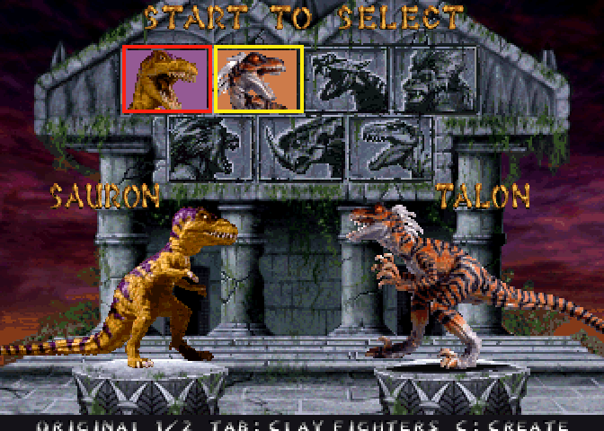
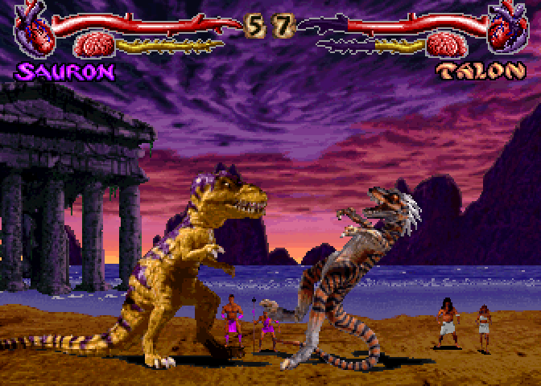
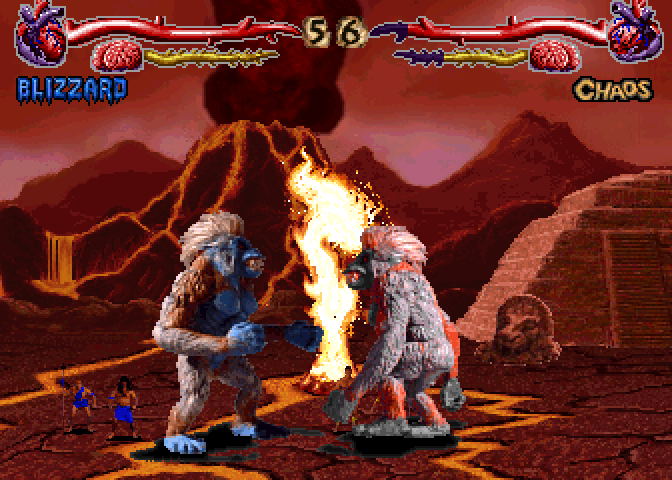
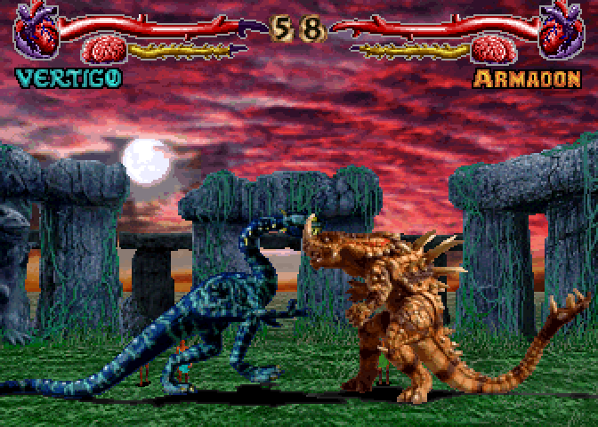
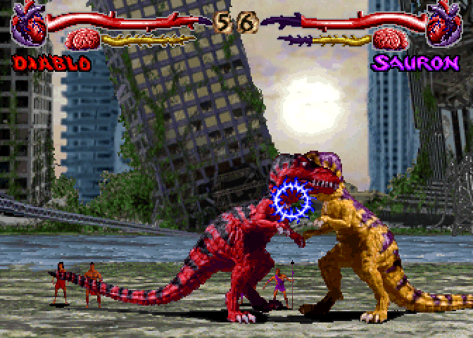
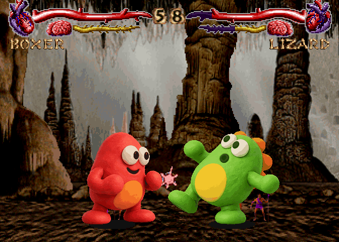

# Clayfight

Clayfight is a **Primal Rage arcade reimplementation** in standalone C, extended
with custom clay fighters made from photographs.

Desktop uses SDL2; iPhone/iPad use UIKit, AVFoundation and native
touch/GameController input. The game has no dependency on Nile Archive or Lua.

The current runtime reads the supported Primal Rage 2.3 December 1994 arcade
chips directly: original RLE sprites, palettes, animation bytecode, normal and
power moves, stages, HUD, contact artwork and CAGE sounds. Custom clay fighters
use local photos and text definitions. The framebuffer is 672×480, twice the
arcade's 336×240 view.

## Screenshots

Captured directly from the native 672×480 framebuffer.

| Fighter select | Sauron vs. Talon — The Cove |
| --- | --- |
|  |  |
| **Blizzard vs. Chaos — The Inferno** | **Vertigo vs. Armadon — The Tomb** |
|  |  |
| **Diablo vs. Sauron — The Ruins** | **Custom clay fighters — The Hollows** |
|  |  |

[Full-resolution captures and reproduction details](https://github.com/corepunch/clayfight/tree/56b88b9242e1a8bcd1f9b40c390a49451290bfa1/docs/screenshots/2026-11-01).

## Build and play

SDL2 is the only native platform dependency. Python 3 and Node are used by the
workshop and tests; Pillow is needed only by image import/review tools.

```sh
make CFLAGS='-O2 -g -Werror'
make resources                  # validate your local data/primrage chip set
make run
make run ARGS='-fight boxer lizard -cpu'
make run ARGS='-warp select'
```

Place your own supported arcade chips in `data/primrage/`, or import them with
`python3 tools/import_resources.py /path/to/primrage`. ROMs and source recordings
are ignored by Git. DOS data and converted retail definitions are not runtime
inputs. The native iOS project is [ios/Clayfight.xcodeproj](ios/Clayfight.xcodeproj),
scheme **Clayfight**; see [the iOS guide](ios/README.md).

Desktop player one: WASD, R/T for high quick/fierce, F/G for low quick/fierce,
Enter starts. Player two: arrows, O/P and L/semicolon. Pair R+T or F+G for power
attacks. Hold away to guard, down-away against lows; attack buttons cancel guard.
Alternate left/right to recover faster while dizzy. Escape pauses, then Q
returns to the menu; backtick shows hit boxes. Two SDL game controllers are
supported on desktop, and two GameController devices on iOS.

Create Fighter opens the local browser workshop on desktop and native camera,
photo/video import and pose alignment on iOS. Photo sources and drafts remain
in local storage. The desktop helper is `tools/capture_server.py`; the executable
it validates against is `build/clayfight` in this checkout.

## Implementation

- `src/game/`: combat, fighter/CPU state machines, ROM/script decoding, menus,
  campaign, HUD and resource adapters. Gameplay is unchanged by extraction.
- `src/platform/`: desktop SDL input/window/audio and the workshop subprocess.
- `src/support/`: indexed CPU rasterizer, photo processing and stb image decode,
  carried over from Nile Archive with matching pixel output.
- `src/sound/`: standalone CAGE DSP interpreter and command decoding.
- `ios/Clayfight/`: native host, camera workshop and native platform adapters.
- `data/creatures/`, `assets/concepts/`, `docs/`: runtime photos, source atlases,
  prompts, asset/state catalogue and reviewed captures.

See [Primal Rage combat](docs/primal-rage-combat.md) for fighter/AI behavior and
fidelity limits, [the arcade catalogue](docs/primal-rage-arcade.md) for artwork,
and [creature format](docs/creature-format.md) for authored fighters.

## Verification

```sh
make test                       # no ROMs: combat, pixels, photos, SDL input, JS
make test-retail                 # focused ROM combat plus real workshop publication
make test-full                   # explicit complete arcade audit/capture export
make lint                       # source paths, project references, Python syntax
```

`build/test-combat` accepts name filters, `--list`, `--retail` and optional
`--captures <existing-directory>`. One invocation runs every selected combat
case. The retail case validates 280 animation/move slots, all original power
choices, real guard collisions, seven CPU styles and photo dizzy fallbacks.
The `animation_` cases cover bounded walking, all 280 ROM script entries,
1,430 jump/attack/landing/recovery sequences across the loaded roster and every
available photo animation in both facings. See the
[animation audit](docs/primal-rage-scripts.md#jump-attack-and-recovery-audit).

## Migration

This checkout restores Clayfight as a standalone arcade-only project from
Nile Archive commit `5de9dcf`. DOS loaders, conversion tools, x86 AI/oracles and
unused DOS reference data have been removed. Existing repository history is
retained. See [MIGRATION.md](docs/MIGRATION.md) for provenance, verification and
local asset locations.
