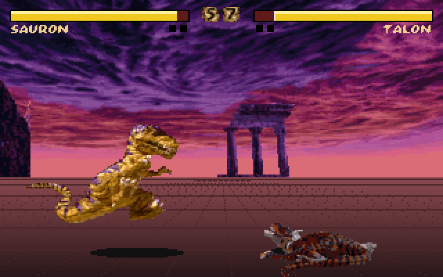
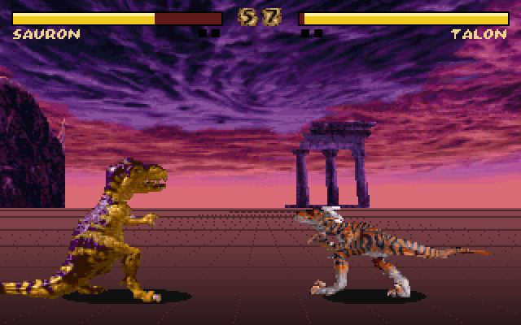

# Primal Rage PC fighter AI

Clayfight's CPU now uses the installed PC game's own AI tables. The shared
random attack/retreat policy has been removed. `src/game/p_enemy.c` ports the
native decision/playback routines and reads relocated data with `X_U*`.
No extracted game tables or executable bytes are checked in.

## Source and reproduction

This describes the installed PC `PRAGE.EXE`, SHA-256
`ea2246b9c9d491392d963fd53689f56554bb7335f3e9614f9655ebc9bc18494d`.
Addresses below are relocated LE virtual addresses, not file offsets.
`PA_Init` checks the dispatcher/table layout and rejects unsupported data;
it does not substitute a guessed policy.

```sh
python3 -B tools/primal_ai.py primalrage build/primal-ai.json
python3 -I tools/extract_scripts.py primalrage build/scripts.json
make checkai
python3 -m venv /tmp/clayfight-ai-venv
/tmp/clayfight-ai-venv/bin/python -m pip install -r tests/requirements-ai.txt
make checkai-original AI_PYTHON=/tmp/clayfight-ai-venv/bin/python
```

The emulator environment takes about 50 MB; decoded AI JSON about 6 MB. No
models, large dependencies or remote storage are needed. Keep exported JSON
under `build/` because it is derived from the user's game.

## The records, fully decoded

| Fighter / code | Joystick macros | Ten-slot matrices | Distinct response tables |
|---|---:|---:|---:|
| Sauron / rr | 95 | 100 | 168 |
| Blizzard / bb | 130 | 117 | 164 |
| Talon / tt | 128 | 87 | 166 |
| Vertigo / vv | 106 | 122 | 170 |
| Armadon / ss | 118 | 79 | 163 |
| Diablo / dd | 77 | 99 | 166 |
| Chaos / cc | 88 | 109 | 164 |

There are **742 macros, 713 matrices and 6,811 matchup/context entries**
(7 fighters × 7 opponents × 139 contexts). Entries share response tables.
The extractor follows the immediate operands of the native dispatcher
switches, rather than assuming that all debug-name runs align with all data
pointer arrays. The old extractor mislabelled some response pointers, especially
Blizzard's. Runtime name pointers are retained even where unused debug slots
are null or not valid strings.

1. **Matchup dispatch, `0x470FC` and `0x471B8`.** The table at `0xE6444` is
   indexed by `fighter * 10 + opponent`. Each pointer addresses 139 response
   pointers. Debug names use the parallel table at `0xE65D4`.
2. **Distance response, `0x47314`.** `atmn_*` records are four bytes:
   `(matrix_id, weight_profile, inclusive_min_distance, inclusive_max_distance)`.
   They are **distance bands, not probability ranges**. Native distance is
   `min(abs(x0-x1)/64, 255)`, using the positions updated by `0x1873C`.
   The first matching band wins. At a shared boundary, the earlier band wins.
   The native search scans up to 20 records and falls back to the first; it
   does not stop on a band's maximum of 255. The export preserves this full
   search window as well as the nominal bands, including adjacent-table
   reads through gaps.
3. **Macro matrix, `0x4748C`.** Every formerly opaque `mvm_*` ten-byte record is
   ten unsigned macro IDs, ordered from column 0 through 9. Repeated IDs are
   deliberate. These bytes contain no timing or probability values.
4. **Weights, `0xE6764`.** Three profiles × eight difficulty levels × ten
   signed percentage bytes. The selected response supplies the profile.
   The native selector draws `random(100)` and adds nonzero weights in
   column order. It picks the first cumulative total **greater than or equal
   to** the roll. Column 9 is the unconditional fallback. Preserve that
   comparison, including roll zero; do not renormalize weights to sum to 100.
5. **Joystick macro, `0x47E5C`.** Eight-byte `(u32 input_pattern, u32 duration)`
   pairs, terminated by input `0xFFFF`. The native duration comparison reads
   a signed 16-bit duration; step and elapsed counters are bytes. The first
   step begins at elapsed zero, the comparison happens before incrementing,
   and a terminator emits a neutral tic before another macro can start.
   Playback continues during action lockout; lockout prevents new decisions.
6. **Facing conversion, `0x3CEB8`.** Bits 16..19 encode toward/away edge/held
   independently. Conversion produces an absolute 16-bit joystick word:
   low byte is pressed edges, high byte is held buttons. Neither channel
   can be reconstructed from the other. Clayfight keeps both in `ticcmd_t`.

For example, Sauron's idle response selects matrix 0 over distance 0..100,
matrix 1 over 100..200 and matrix 2 over 200..255; the shared endpoints belong
to the earlier band. Each matrix then offers ten authored macros, with the
appropriate difficulty profile controlling the choice.

## Observations and interruptions

`0x46EE8` classifies the opponent using native motion/action/stance bytes,
move ID, whether an attack connected, special-state predicates and previous
observed state. `0x471B8` maps that classification to a response context:

| Classification | Context |
|---|---|
| New normal attack | Move ID 0..63 |
| Continuing attack | Move ID +64, or 136 while the original +0x8A flag is set |
| Idle | 130 |
| Crouch | 133 |
| Jump | 135 |
| Walk toward / away | 131 / 132 |
| Dizzy / recovery | 129 / 134 |
| Native action 6 | Special ID, or 136 when unset |
| Other / native stationary airborne state / incoming object | 136 / 137 / 138 |

`0x47638` interrupts a macro for a new normal attack, or on entering dizzy
or recovery. These interruptions are suppressed while the CPU's native stance
is airborne (2). New macros may only start while its action byte is zero.
Round setup clears each fighter's entire decision state. Intro, pause,
training-dummy time and impact freeze do not consume AI playback tics.

## Clayfight integration and limits

Original fighters inherit their own `prage` character identity. `ai N` in a
creature file overrides the style/matchup identity; custom creatures without
it use Sauron (0). The three menu difficulties map explicitly to native
levels 0, 3 and 6. Native arcade/adaptive difficulty progression is not ported.

`P_AiView` translates current Clayfight animations, move IDs and hit state to
native observations. PC-world X separation is converted to native subunits
with the existing `ARCADE_XSCALE`; Clayfight does not reproduce the original
sprite-position adjustment machinery. Unavailable native special/object states
are not invented by the adapter. The low-level implementation supports them
and its oracle exercises them.

Random draws come from the deterministic simulation RNG, replacing the
original PIT hardware entropy. The oracle injects identical entropy draws
into the original, then executes its own multiplication/scaling routine.

Macros containing specials, throws or projectiles are preserved and emitted
unchanged. Clayfight still lacks those native combat handlers. Its movement,
collision and damage resolution remain the prototype's rules, including the
existing button-priority policy. Thus decision/input parity does not imply
pixel-identical fights or working original specials. There is no remapping of
unavailable specials into arbitrary replacement attacks.

The native app bundles the local `PRAGE.EXE` alongside INDEX and GRA files
because CPUs now need these tables even without `-script`.

## Verification

`tests/ai_original.py` loads the same relocated executable into Unicorn and
compares the production C state with the original's complete 64-byte AI state,
including selected data/name pointers, counters and timing. Its only external
hooks replace hardware entropy and the disabled debug-menu query. No classifier,
selector, distance routine, facing conversion or macro player is replaced by a
hook. The weighted-selector tail is entered through a small test call-frame
trampoline after the separately verified response and distance selectors.

The reviewed run passed **144,791 differential cases**:

- 616 raw-observation classifier cases, including remembered attacks and native states;
- 19,894 matchup/context dispatches, covering every normal move and context index;
- 23,667 distance boundary cases across every distinct runtime response;
- 16,800 selections covering every roll 0..99 at all 8 levels and 3 profiles for all fighters;
- 57,354 playback tics covering every macro through termination in both facings;
- 26,460 integrated decision-stream tics across all 49 matchups at levels 0, 3 and 6,
  comparing input, full state and random-call counts through interruptions and lockout.

`make checkai` additionally drives real Clayfight matches in one process across
49 pairings × three menu difficulties, checks attack execution and custom
creatures, and exercises pressed/held channels, script move IDs and state reset.
The existing 266-animation conversion check remains a separate check.

## Reviewed game captures

Same Sauron versus Talon CPU match, 360 tics from a fresh deterministic start,
640×400. Different poses/health are expected because the decision policy changed.
These show the running integration; the x86 comparisons above verify behavior.

| Shared prototype AI, before | Original-table AI, after |
|---|---|
|  |  |

```sh
SDL_VIDEODRIVER=dummy SDL_AUDIODRIVER=dummy ./clayfight \
  -fight sauron talon -cpu -nosound -shots build/ai-after \
  -every 360 -tics 361
```

The before capture was taken with the pre-change executable using the same
match and frame. Convert the BMP to PNG without resizing for the docs.
